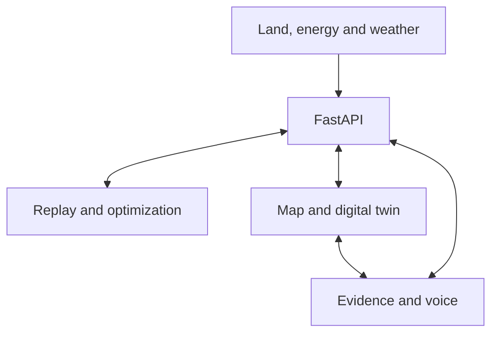
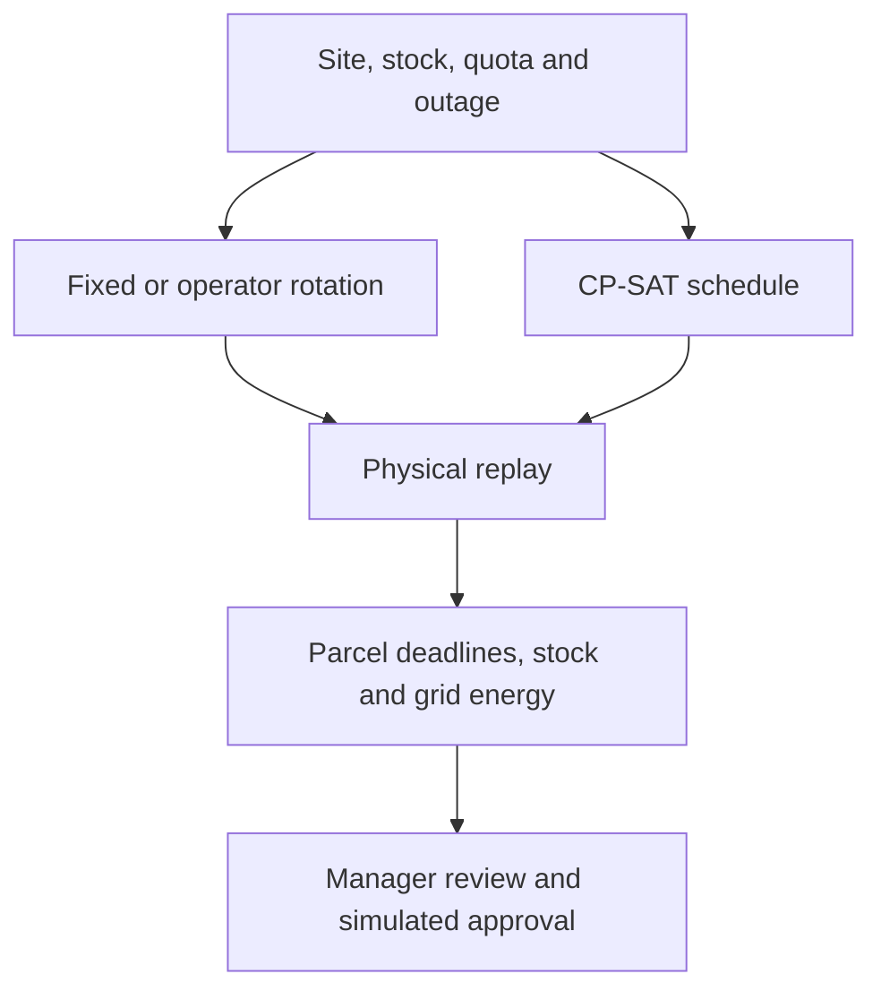
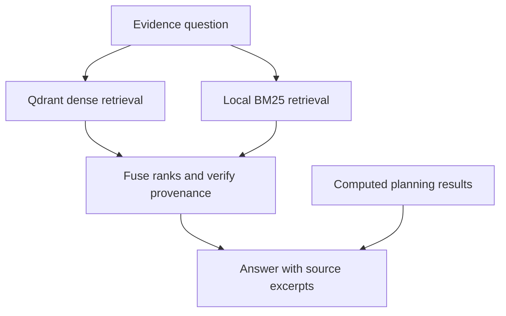
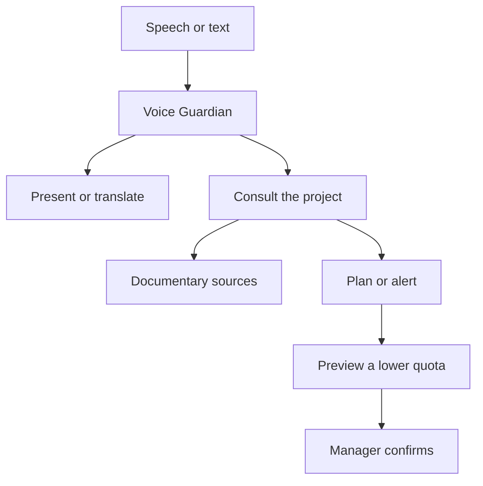

<picture>
  <source media="(prefers-reduced-motion: reduce)" srcset="docs/readme-hero-still.svg">
  
</picture>

<h1 align="center">MIZUHO</h1>

<p align="center"><em>When a power cut interrupts pumping, which parcels can still receive their promised water on time?</em></p>

<p align="center">
  <a href="#how-it-works"></a>
  <a href="#use-the-dashboard"></a>
  <a href="#voice-and-evidence"></a>
  <a href="#voice-and-evidence"></a>
  <a href="#reproduce-the-pilot"></a>
</p>

<p align="center">
  <a href="https://github.com/omarfh111/MIZUHO/actions/workflows/ci.yml?query=branch%3Amain"></a>
  <a href="https://github.com/omarfh111/MIZUHO/actions/workflows/security.yml?query=branch%3Amain"></a>
  
  
  
  
  
</p>

<p align="center">
  <a href="#run-mizuho">Setup</a> · <a href="#use-the-dashboard">Dashboard</a> · <a href="#data-and-provenance">Data and provenance</a> · <a href="#how-it-works">Architecture</a> · <a href="#voice-and-evidence">Voice and evidence</a> · <a href="#api-reference">API</a> · <a href="#checks">Checks</a>
</p>

MIZUHO helps a Tunisian irrigation manager answer that question. Explore a site, compare its usual rotation with a constrained plan, then replay the consequences for each parcel, the reservoir and the electricity supply. A farmer can ask for an explanation. The manager reviews the proposal before approving it in the simulator.

In the reproducible Jendouba A/B case, both schedules have 10 m³ in storage and zero remaining withdrawal quota. The fixed turn gives A all 10 m³. The optimized plan gives each parcel 5 m³, raising the least-served parcel’s coverage from **0% to 50%**. This is a simulated result under documented assumptions. [Run the example](#reproduce-the-pilot)

## Run MIZUHO

Run the FastAPI backend and React dashboard together. Use **Python 3.12**, **Node.js 22.12 or newer** and npm. The connected evidence assistant needs an OpenAI key with access to the configured models and a Qdrant Cloud cluster. Add Vultr inference credentials to use microphone transcription and synthesized speech.

```sh
git clone --branch main https://github.com/omarfh111/MIZUHO.git
cd MIZUHO
```

Create the Python environment and the private backend configuration using the commands for your shell.

**macOS or Linux**

```sh
python3.12 -m venv .venv
. .venv/bin/activate
cp .env.example .env
```

**Windows PowerShell**

```powershell
py -3.12 -m venv .venv
.\.venv\Scripts\Activate.ps1
Copy-Item .env.example .env
```

From the repository root, with the environment active, install both sets of dependencies.

```sh
python -m pip install --upgrade pip
python -m pip install -r requirements-dev.txt
npm --prefix frontend ci
```

### Configure the services

Set credentials in the root `.env`. Keep it private. The frontend only needs the connection mode. [Backend configuration template](.env.example)

| Service | Root `.env` settings |
| --- | --- |
| OpenAI answers and embeddings | Set `OPENAI_API_KEY`. The shipped configuration selects `OPENAI_MODEL=gpt-6-luna`, `OPENAI_EMBEDDING_MODEL=text-embedding-3-small` and `EMBEDDING_DIMENSIONS=1536`. |
| Qdrant Cloud | Set `QDRANT_URL` to the HTTPS cluster origin and `QDRANT_API_KEY` to a key that can read and write the collection. The default `QDRANT_COLLECTION` is `mizhuo_m8_evidence_v1`. |
| Optional NVIDIA answer model | Set `LLM_API_KEY` and `LLM_MODEL=nvidia/nemotron-3.5-lightning-30b-a3b` to enable this choice in **Ask Mizhuo**. OpenAI still supplies the embeddings. |
| Voice Guardian | Set `VULTR_INFERENCE_API_KEY` for live speech. The template selects Whisper for transcription, Qwen3 for English/Japanese speech and a Vultr language model for conversation and translation. Derja playback uses Chatterbox’s Arabic voice. |
| Manager review | Set `MIZHUO_MANAGER_APPROVAL_CODE` to require a private code when confirming a withdrawal quota reduction through Guardian. With the default empty value, the local demonstration trusts its operator. |

In the Qdrant Cloud console, create the collection named in `QDRANT_COLLECTION` with **one unnamed dense vector, size 1536, Cosine distance**. For an existing collection, verify those settings. Run the indexer from the repository root. The first command indexes the checked-in excerpts and reuses points with matching content hashes. The second reads the index status. A complete index reports `status` of `available` and `indexed_chunks` equal to `expected_chunks` (seven for the included corpus). [Corpus manifest](data/m8_corpus.json)

```sh
python -m backend.evidence
python -m backend.evidence --check
```

Create `frontend/.env.local` with this line, then start Vite after saving the file.

```dotenv
VITE_DATA_MODE=live
```

**Terminal 1** — at the repository root with the Python environment active:

```sh
python -m uvicorn backend.main:app --host 127.0.0.1 --port 8000
```

**Terminal 2** — at the repository root:

```sh
npm --prefix frontend run dev -- --host 127.0.0.1 --port 5173 --strictPort
```

Open the dashboard. Confirm `/api/health` reports `ok`, then open assistant health to check the index. Planning, archived maps and simulated telemetry run locally even when an inference provider is unavailable. The dashboard distinguishes provider availability from the status of the physical simulation. [Dashboard](http://127.0.0.1:5173/) · [Backend health](http://127.0.0.1:8000/api/health) · [Assistant health](http://127.0.0.1:8000/api/assistant/health)

## Use the dashboard

Choose English, Japanese or Tunisian Derja from the language selector. The three workspaces follow the same decision from location to resources to schedule.

| Workspace | What to try |
| --- | --- |
| **Land & agriculture** | Select one of Tunisia’s 24 governorate capitals, inspect its dated climate profile, then open a registered site. Rotate the terrain, select a parcel or equipment item and open its provenance. The cinematic introduction supports skip, replay and reduced motion. |
| **Water & energy** | Inspect the Bouhertma radiation archive and compare PV options for Jendouba. At Assila, inspect the dated WaPOR survey. At a regional study site, use its own climate and energy inputs. |
| **Irrigation planning** | Edit stock, quota, demand, pump, solar, gravity and outage assumptions where the site has a planning model. Calculate schedules under identical constraints. Compare parcel commitments, unmet demand and grid use, then replay the selected hour in the digital twin. Input changes invalidate the previous result. |
| **Outage resilience** | In planning, open **Test outage resilience**, choose the coverage target and select **Run outage grid**. A full day offers 16 start-time/duration combinations. Open a case to compare sharing rules, check the reserve needed when attainable, and replay its first shortfall. Test a physical leak versus a faulty meter, three days of heat with a cumulative quota, or a larger tank versus island-capable backup. |
| **Community electricity** | For an outage, enter household counts, essential and lighting loads, usable backup energy and inverter capacity. Inspect hourly unmet demand and the first shortfall. This models a separate household circuit. |
| **Recorded deliveries** | Import a completed day of anonymous commitments and meter readings in **Check a recorded delivery day**. Missing readings stay unknown. Files are parsed in browser memory. Seven sites have explicitly simulated example CSVs. Assila’s template supplies mapped parcel IDs with blank observations. [CSV examples](frontend/src/assets/delivery-examples/) |

## Reproduce the pilot

1. Open **Irrigation planning**, select **Jendouba** and **A/B demo**, then **Calculate schedules**. Switch between the fixed and optimized schedules and inspect the time of delivery in the replay.
2. Ask **Ask Mizhuo** “Why did grower A receive only 5 m³?” with that result selected. Then ask “What does ANME say about photovoltaic potential in northwest Tunisia?” and open the cited excerpt. The first answer uses computed deliveries. The second uses documentary evidence.
3. Select **Day-ahead weather reserve**. With adverse weather and a 7 m³ remaining quota, the reserve plan pumps 2 m³ before 11:00 and delivers 8 m³ on time. The nominal plan, calculated for central weather and replayed on that same adverse day, delivers 6 m³. With a 5 m³ quota both deliver 6 m³ and leave 2 m³ unmet. The stable profile delivers 8 m³ with either rule and needs no early pumping.
4. At a regional site such as **Gafsa · El Ksar**, select an archived day and review the equipment and parcel assumptions before calculating. Compare January and July with the same inputs. The terrain, irradiation and resulting electric output belong to the selected place and date. [Regional inputs and reproduction](data/zone_planning/README.md)

To reproduce step 1 against the running backend, execute this Python snippet from the repository root in the project environment. The checked-in fixture contains the request and the expected results. [Comparison fixture](data/fixtures/compare.json)

```python
import json
from pathlib import Path

import httpx

fixture = json.loads(Path("data/fixtures/compare.json").read_text(encoding="utf-8"))
response = httpx.post("http://127.0.0.1:8000/api/compare", json=fixture["request"], timeout=30)
response.raise_for_status()
comparison = response.json()
for plan in ("baseline", "optimized"):
    deliveries = {p["plot_id"]: p["delivered_on_time_m3"] for p in comparison[plan]["plot_results"]}
    print(plan, deliveries)
```

| Jendouba A/B result | A on time | B on time | Least-served coverage | Additional withdrawals |
| --- | ---: | ---: | ---: | ---: |
| Fixed rotation | 10 m³ | 0 m³ | 0% | 0 m³ |
| Optimized sharing | 5 m³ | 5 m³ | 50% | 0 m³ |

## Data and provenance

The catalogue contains **eight sites**. Jendouba is the fictional engineering pilot. Assila supplies mapped parcel boundaries. Six regional studies cover **Korba (Cap Bon), Chebika (Kairouan), El Ksar (Gafsa), Mateur (Bizerte), Sidi Bouzid and El Hajeb (Sfax)**. Each regional study pairs a local terrain model with an explicitly hypothetical irrigation station. The atlas of 24 cities provides geographic context beyond the planning sites.

| Data | What it supports |
| --- | --- |
| **Reported instrument observations** | Bouhertma has 2,529 archived hourly FieldClimate solar-radiation records in W/m². Missing hours have no measurements and the publisher did not specify a timezone. This series describes one station. [Station archive](data/weather/BOUHERTMA.md) |
| **Mapped parcels and satellite estimates** | Assila has five OpenStreetMap parcel geometries and dated FAO WaPOR actual evapotranspiration estimates. Planning still needs verified crop, demand, irrigation windows, equipment and quota. A satellite ET estimate alone cannot establish a water entitlement or a complete irrigation requirement. [Assila survey and source metadata](data/agriculture/assila/) |
| **Regional geography and climate** | The atlas uses archived NASA POWER climate, governorate boundaries and Copernicus elevations. The six study zones use satellite imagery, WorldCover land cover and local elevation samples. Their planning archives contain 15 January and 15 July 2025. Regional demand estimates combine reference ET and rain with explicit crop, area and efficiency assumptions. [Atlas sources](data/tunisia/README.md) · [Regional sources and attribution](data/field_zones/README.md) |
| **Energy estimates** | Archived PVGIS production and locally modelled solar profiles support energy comparisons. Avoided grid energy and estimated savings depend on the connected load, tariff and scenario. [Jendouba energy inputs](data/energy/jendouba-pilote.json) |
| **Simulated equipment and telemetry** | Jendouba’s five plots and the regional stations’ two delivery sectors model design choices. Virtual sensors project physical results into timestamped readings with units and quality flags. A missing flow reading remains missing. A 13 m³ unexplained balance prompts a meter and tank inspection. [Operating examples](docs/judge-validation.md) |
| **Field validation** | Operators can compare anonymous, dated deliveries with their commitments. Using the planner for an actual station requires its measured capacities, approved allocations and local operating rules. [Pilot validation protocol](docs/v5-capability-audit.md#how-a-water-group-could-validate-the-pilot) |

## How it works

During a replay, trigger an unexpected outage or pump shutdown to see which commitments can still be met. Inject a missing or inconsistent meter reading to compare the instrument with the physical ledger. The day-ahead load forecast evaluates a Ridge model against held-out simulated load history. [Operating scenarios and verification](docs/integration-v5.md#judge-walkthrough)

Site, solar and weather data supply the planning inputs. The physical simulator tracks water and energy balances. The OR-Tools CP-SAT optimizer searches for a schedule, which the simulator then replays to check feasibility. The React, TypeScript and Three.js dashboard accesses these services through FastAPI and Pydantic. Ask Mizhuo explains the results, and Voice Guardian supports spoken interaction. [Integration architecture and module history](docs/integration-v5.md)



The manager can replay a fixed turn or enter an hourly operator rotation. The solver prioritizes the worst-served parcel’s minimum coverage under the default fair rule and considers deferral-weighted shortfall, delivered volume and energy objectives in sequence. The simulator enforces tank capacity, withdrawal quota, permitted delivery windows and available power. It reports which deliveries met each parcel’s deadline. Gravity-fed delivery may continue during an outage while stock remains. Incident replanning preserves completed actions. A time-limited solve carries its returned status into the comparison. [Canonical planning contract](backend/models.py) · [Planning implementation](backend/optimizer.py)



## Voice and evidence

**Ask Mizhuo** uses one LangGraph agent. Its tools can consult site and city data, agricultural insights, current simulation results, decision explanations, sensor anomalies and documentary evidence. Search combines OpenAI embeddings in Qdrant with local BM25 and fuses the rankings. Citations open the source passage and its provenance. Numerical simulation claims come from application tools. The seven indexed passages cover sources including ANME, FAO, INS, SONEDE, DGRE and the World Bank. Missing local borehole and site-economics evidence is recorded explicitly. [Verified excerpts](docs/evidence/) · [English, French and Arabic retrieval benchmark](docs/m8-retrieval-benchmark.md)



The evidence assistant keeps up to six grounded turns in process per session, expires idle sessions after one hour, and invalidates stale numerical context when planning inputs change. Restarting the backend clears that memory. A follow-up can refer to a previous citation or a current plan.

**Voice Guardian** starts as a conversational presentation and accessibility assistant. An urgent replay alert or missing planning input can also offer an in-app conversation that the operator can accept or dismiss. Open **Live voice** for hands-free turns, or **Voice assistant** to type or submit a clip. Ask it to present the project in Japanese, translate a phrase into Tunisian Derja, or explain a selected alert. An explicit source request or the **Sources** mode can route the question to the evidence assistant. The built-in project briefing supports follow-up questions. **Presenter notes** accepts pasted text or a UTF-8 `.txt` or `.md` script up to 4,000 characters for the call. Personalized speech and translation can send notes to the configured provider. Derja pronunciation needs evaluation with local speakers. [Multilingual project briefing](data/guardian/project-presentation.json)



## API reference

The running API publishes request and response schemas, units, validation rules and interactive examples. Voice Guardian uses a separate WebSocket connection. [Swagger UI](http://127.0.0.1:8000/docs) · [OpenAPI JSON](http://127.0.0.1:8000/openapi.json)

| Capability | Method and path |
| --- | --- |
| Service and catalogue | `GET /api/health` · `GET /api/sites` · `GET /api/scenarios` |
| Map and agriculture | `GET /api/layers/{site_id}/{layer_id}` · `GET /api/sites/{site_id}/agriculture` · `GET /api/sites/{site_id}/field-zone` |
| Tunisia atlas | `GET /api/tunisia` · `GET /api/tunisia/cities/{city_id}` (optional inclusive `start` and `end` dates) |
| Regional planning | `GET /api/sites/{site_id}/planning` · `POST /api/sites/{site_id}/planning` · `POST /api/sites/{site_id}/demand-estimate` |
| Planning and operator rotation | `POST /api/compare` · `POST /api/sites/{site_id}/operator-rotation` |
| Solar and weather | `POST /api/solar/compare` · `POST /api/solar/compare-archive` · `POST /api/solar/profile` · `POST /api/weather` · `GET /api/weather/bouhertma` (optional `day`) |
| Telemetry and forecasting | `POST /api/telemetry/project` · `POST /api/telemetry/replay` · `POST /api/telemetry/forecast` |
| Resilience | `POST /api/sites/{site_id}/resilience/grid` · `POST /api/sites/{site_id}/resilience/case` · `POST /api/resilience/households` |
| Documentary evidence | `GET /api/evidence/{source_id}` · `GET /api/evidence/{source_id}/passages` · `POST /api/evidence/search` |
| Evidence assistant | `POST /api/assistant/chat` · `GET /api/assistant/health` · `GET /api/assistant/index` |
| Voice Guardian | `WS /api/guardian/call` |

## Checks

Run from the repository root with the Python environment active. The frontend build also runs TypeScript checks. For the browser suite, run both servers on an isolated local test instance with Google Chrome installed. CI leaves provider keys and the manager code empty so the tests can exercise approval and voice interactions with test audio. Keep your connected demonstration’s keys and settings separate.

```sh
python -m pytest -ra
npm --prefix frontend test
npm --prefix frontend run build
npm --prefix frontend run test:integration
```

GitHub Actions runs backend tests, frontend tests, TypeScript, the production build and a separate **Digital twin browser tests** job. The security workflow runs CodeQL and a redacted Gitleaks scan. Dependency review compares advisories for manifest changes on pull requests. [CI workflow](.github/workflows/ci.yml) · [Security workflow](.github/workflows/security.yml)

For an opt-in provider check, `npm --prefix frontend run test:browser` exercises the cinematic and connected evidence flows. `python -m tools.guardian_smoke --live` checks the speech service. `node frontend/tests/guardian-live-browser.mjs --live` runs the browser voice path with synthetic speech. These live checks can incur provider charges. [Voice smoke test](tools/guardian_smoke.py) · [Voice browser test](frontend/tests/guardian-live-browser.mjs)

### Serving a build

Set `VITE_DATA_MODE=live` before `npm --prefix frontend run build` and serve `frontend/dist`. Route same-origin `/api` requests to FastAPI and forward WebSocket upgrades on `/api/guardian/call`. Preserve the public host and scheme at the proxy or allow its exact HTTPS origin in `MIZHUO_CORS_ORIGINS`. Browser microphone access requires HTTPS or localhost. For local development with a different backend address, set `MIZU_API_TARGET` for Vite. Keep provider credentials on the backend. The included manager confirmation and process-local assistant sessions are designed for a supervised demonstration.
