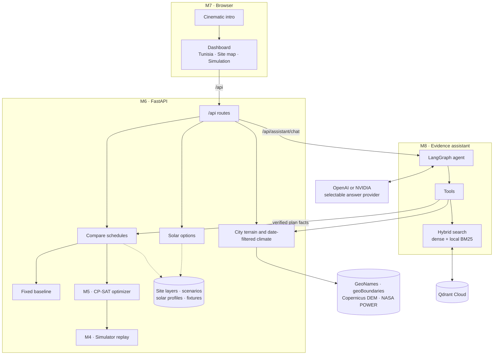
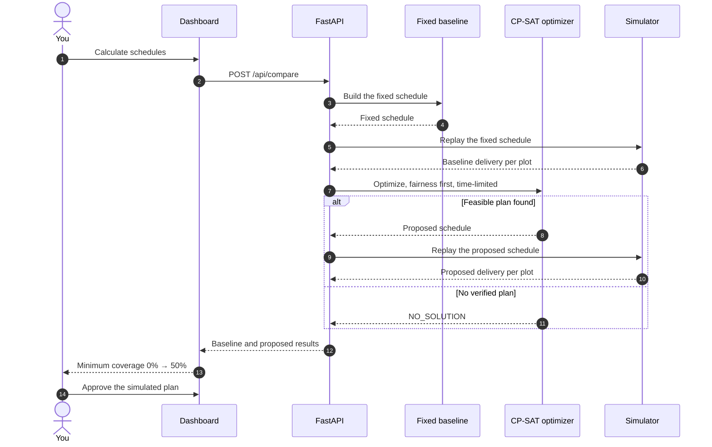
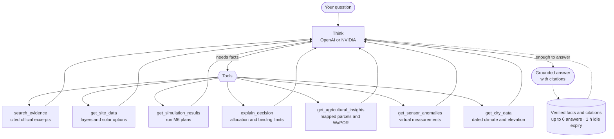
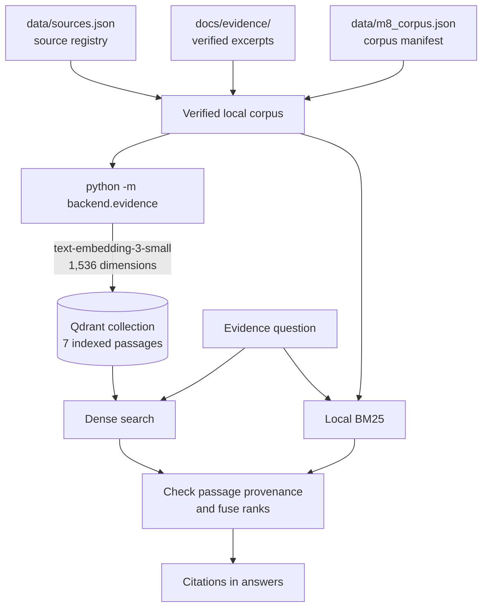

<div align="center">

<picture>
  <source media="(prefers-reduced-motion: reduce)" srcset="docs/readme-hero-still.svg">
  
</picture>

<h1>MIZUHO</h1>

<p><em>Renewable-powered water intelligence for Tunisian agriculture.<br>Map the Jendouba pilot, compare irrigation schedules during a power outage, and ask an evidence assistant why.</em></p>

[](#how-it-works)
[](#how-it-works)
[](#how-it-works)
[](#reproduce-the-pilot)

[](https://github.com/omarfh111/MIZUHO/actions/workflows/ci.yml?query=branch%3Amain)


[How it works](#how-it-works) · [Data and provenance](#data-and-provenance) · [Run MIZUHO](#run-mizuho) · [Reproduce the pilot](#reproduce-the-pilot) · [API reference](#api-reference) · [Checks](#checks)

</div>

---

| Module | What you can reproduce |
| --- | --- |
| **M1 · Assila survey** | Explore five mapped parcels and dated WaPOR estimates with source metadata. Inspect missing farmer, demand, quota and scheduling data. |
| **M2/M3 · Energy and telemetry** | Use archived PVGIS profiles, inspect a held-out load forecast and replay virtual sensors with controlled faults. |
| **M6 · API and irrigation planning** | Load the site and scenarios, compare solar options, and run the M4 simulator and M5 CP-SAT optimizer through FastAPI. |
| **M7 · National map and 3D dashboard** | Zoom from Tunisia to one of its 24 governorate capitals. Explore local relief and climate, open a nearby surveyed or simulated site when available, and replay the [cinematic introduction](frontend/src/experience/README.md). |
| **M8 · Evidence assistant** | Search official passages with Qdrant dense retrieval and BM25. Ask about a city's archive or the current site simulation with the same LangGraph agent. |

## How it works

One browser app talks to one FastAPI service. The country map zooms to georeferenced city terrain. Known field sites connect that view to M1 profiles, M2 solar comparisons, M3 virtual telemetry and M4/M5 planning. M8 explains the evidence and results available in the active view.



<sub>Vite proxies <code>/api</code> to FastAPI on port 8000 in development. The dashboard distinguishes the simulated planning pilot from the Assila survey. The operational twin reads the M4 ledger and M3 virtual measurements through FastAPI.</sub>

### Planning through an outage (M6)

The fixed schedule and the optimized plan are computed from the same scenario, then both are replayed through the simulator so the dashboard compares like with like.



<sub>In the A/B demo the fixed schedule delivers 10 m³ to A and 0 m³ to B during the outage. The proposed schedule delivers 5 m³ to each. When the solver returns no solution, the fixed schedule stays available.</sub>

### Answering with evidence (M8)

The assistant uses a single two-node LangGraph loop with OpenAI or NVIDIA for answer generation. It selects from seven tools across its city and site contexts. The city context exposes sourced terrain and climate plus documentary search. The site context adds the agricultural survey, M6 calculations and M3 replay measurements.



### From sources to citations

Every citation resolves to a verified excerpt of a registered source. Stable IDs and content hashes let re-ingestion reuse unchanged embeddings.



<sub>The <a href="docs/m8-retrieval-benchmark.md">retrieval benchmark</a> compares dense and hybrid search on 36 English, French and Arabic questions.</sub>

## Data and provenance

| Data | What the application uses |
| --- | --- |
| Mapped geography | GeoNames governorate capitals, geoBoundaries administrative areas, and OpenStreetMap parcel boundaries for the Assila survey. |
| Archived regional estimates | Copernicus DEM surface elevations for city terrain, NASA POWER gridded daily climate, FAO WaPOR satellite-derived water use, and JRC PVGIS solar generation estimates. The date filter recalculates climate statistics from the archived daily values. |
| Archived instrument observations | The Bouhertma FieldClimate archive provides measured hourly solar radiation in W/m² at one station. |
| Simulated data | Jendouba planning scenarios, physical replay, virtual pump and flow readings, load history, and injected faults. The 13 m³ discrepancy is a demonstration case. |

City profiles show the source, coverage, and retrieval date. A city needs verified parcels, water allocation, equipment specifications, and starting conditions before it can be used for operational planning. The built-in planning pilot uses simulated conditions. [National data refresh and sources](data/tunisia/README.md) · [Data manifest](data/manifest.json)

## Run MIZUHO

Use Git, Python **3.12** and Node.js **22.12 or later**. Once dependencies are installed, the local backend and frontend run the maps, optimizer, digital twin, forecast and event demonstrations without credentials or network access. Configure OpenAI and Qdrant in step 2 for conversational answers and indexed retrieval.

### 1. Clone and install

Run these commands from PowerShell. On macOS or Linux, use `.venv/bin/python` wherever the commands show `.\.venv\Scripts\python.exe`.

```powershell
git clone --branch main https://github.com/omarfh111/MIZUHO.git
cd MIZUHO
python -m venv .venv
.\.venv\Scripts\python.exe -m pip install -r requirements-dev.txt
npm --prefix frontend ci
Copy-Item .env.example .env
```

### 2. Configure the optional connected assistant

Open the root `.env` and fill in these three fields. The root file is loaded by the backend and ignored by Git.

| Field | Required value |
| --- | --- |
| `OPENAI_API_KEY` | The OpenAI project key. |
| `QDRANT_URL` | The HTTPS REST endpoint of your Qdrant Cloud cluster, for example `https://<cluster>.cloud.qdrant.io:6333`. Use the cluster URL without a dashboard or collection path. |
| `QDRANT_API_KEY` | The Qdrant API key for the evidence collection. |

To use NVIDIA for answer generation, set `LLM_API_KEY` to your NVIDIA API key and `LLM_MODEL=nvidia/nemotron-3.5-lightning-30b-a3b` in the root `.env`. Restart FastAPI and select **NVIDIA · Nemotron 3.5 Lightning** under **Ask Mizhuo → Answer model**. The default is OpenAI. Both models use the same LangGraph tools, M6 calculations, OpenAI embeddings, Qdrant index and citation checks. Selecting NVIDIA sends the question and relevant verified context to NVIDIA's hosted API. Provider credentials stay on the server.

Keep the template's model settings, including the **1,536** embedding dimensions. Open the cluster's Web UI, enter your Qdrant key when prompted, and select **Console**. Run the request below if the collection does not exist. It uses one unnamed dense vector and cosine distance. If you choose a different name, update `QDRANT_COLLECTION` to match. [Qdrant Web UI guide](https://qdrant.tech/documentation/web-ui/)

```http
PUT /collections/mizhuo_m8_evidence_v1
{
  "vectors": { "size": 1536, "distance": "Cosine" }
}
```

From the repository root, ingest the reviewed excerpts and check that the index reports `"status": "available"` with **7 of 7** passages indexed.

```powershell
.\.venv\Scripts\python.exe -m backend.evidence
.\.venv\Scripts\python.exe -m backend.evidence --check
```

### 3. Start the backend and frontend

In one terminal at the repository root, start FastAPI.

```powershell
.\.venv\Scripts\python.exe -m uvicorn backend.main:app --host 127.0.0.1 --port 8000
```

Create `frontend/.env.local` with this setting so Vite requires the backend connection. Keep the provider keys in the root `.env`.

```dotenv
VITE_DATA_MODE=live
```

In a second terminal at the repository root, start Vite.

```powershell
npm --prefix frontend run dev -- --host 127.0.0.1 --port 5173 --strictPort
```

Open the dashboard and confirm it shows **API · simulated site**. The API health route should report `ok`. With the provider keys and index configured, assistant health should report `available` with seven indexed passages. Ask what ANME says about photovoltaic potential in northwest Tunisia and open the cited excerpt. [Dashboard](http://127.0.0.1:5173/) · [API health](http://127.0.0.1:8000/api/health) · [Assistant health](http://127.0.0.1:8000/api/assistant/health)

Vite proxies `/api` to port 8000. For production, serve `frontend/dist` and route `/api` to FastAPI on the same origin.

## Reproduce the pilot

For a judge walkthrough of the eight operating and sensor demonstrations, see the [integration matrix, architecture and replay guide](docs/integration-v5.md).
Start in **Tunisia**, select a city and inspect its climate period and elevation source. Select **Jendouba** for the nearby simulated field site, or open **Site map** from the main navigation. See the [judge validation report](docs/judge-validation.md) for the field workflow regression coverage.

1. On the **Site map**, enable **Water anomalies** and select the distribution meter to see the simulated **13 m³** discrepancy. Open **Compare solar options** to inspect the two 10 kWp profiles and their assumptions.
2. In **Simulation**, select **A/B demo** and **Calculate schedules**. During the outage, the fixed schedule delivers **10 m³** to A and **0 m³** to B. The proposed schedule delivers **5 m³** to each plot, raising minimum coverage from **0%** to **50%**. Approve the proposed simulated plan.
3. With the A/B result current, open **Ask Mizhuo** and ask *Why did grower A receive only 5 m³ in the A/B demo?* The assistant can use M6's current comparison. Ask *What does ANME say about photovoltaic potential in northwest Tunisia?*, open the citation, then ask *Which official source did you just cite?* to check the session follow-up.
4. Change the water stock to see the result marked stale until recalculated. Select **Day-ahead weather reserve** to see the proposed plan pump **2 m³** before **11:00**, raising on-time delivery from **6 m³** to **8 m³**. With a quota of **5 m³**, the remaining shortfall is **2 m³**. **Day-ahead reserve · Stable profile** requires **0 m³** of early pumping.

### Replay the M6 API fixture

From the repository root with FastAPI running, send the request from the [versioned A/B fixture](data/fixtures/compare.json).

```powershell
$fixture = Get-Content data/fixtures/compare.json -Raw | ConvertFrom-Json
$plan = Invoke-RestMethod http://127.0.0.1:8000/api/compare -Method Post -ContentType application/json -Body ($fixture.request | ConvertTo-Json -Depth 10)
$plan.optimized.plot_results | Select-Object plot_id, delivered_on_time_m3, coverage_bp
```

Expected results are **5 m³** delivered on time and **5,000** coverage basis points for each plot. The backend optimizes fairness before other objectives and replays the returned plan through the simulator. A time-limited solve can return a verified `FEASIBLE` plan. When it returns `NO_SOLUTION`, the fixed schedule remains available.

### Reproduce the M8 retrieval benchmark

```powershell
.\.venv\Scripts\python.exe -m backend.retrieval_benchmark
```

The [benchmark](docs/m8-retrieval-benchmark.md) compares dense and hybrid retrieval for **36 English, French and Arabic questions** against the same seven passages. It uses live OpenAI embeddings and Qdrant queries. The [corpus manifest](data/m8_corpus.json) links the [source registry](data/sources.json) to [verified excerpts](docs/evidence/). Stable IDs and content hashes let repeated ingestion reuse unchanged embeddings.

The assistant keeps up to six grounded answers per app session. It retains public citations and verified tool results, clears stale facts when inputs change, and resets memory after one hour of inactivity or an API restart. Reloading the page starts a new session. The [data manifest](data/manifest.json) records the demonstration assumptions. The solar editor offers archived PVGIS estimates alongside the original simulated profiles. Borehole measurements, field electricity tariffs and installation quotes remain unavailable.

## API reference

The running backend serves [OpenAPI documentation](http://127.0.0.1:8000/docs).

| Purpose | Routes |
| --- | --- |
| Health and geography | `GET /api/health`, `GET /api/scenarios`, `GET /api/sites`, `GET /api/layers/{site_id}/{layer_id}` |
| National map and profiles | `GET /api/tunisia`, `GET /api/tunisia/cities/{id}` with optional inclusive `start` and `end` dates |
| Agricultural survey and weather station | `GET /api/sites/{site_id}/agriculture`, `GET /api/weather/bouhertma?day=2026-05-08` |
| Archived solar comparison, hourly PV and planning weather | `POST /api/solar/compare-archive`, `POST /api/solar/profile`, `POST /api/weather` |
| Verified replay and virtual instrumentation | `POST /api/telemetry/replay`, `POST /api/telemetry/project`, `POST /api/telemetry/forecast` |
| Irrigation and solar | `POST /api/compare`, `POST /api/solar/compare` |
| Sources and retrieval | `GET /api/evidence/{source_id}`, `GET /api/evidence/{source_id}/passages`, `POST /api/evidence/search` |
| Evidence assistant | `POST /api/assistant/chat`, `GET /api/assistant/health`, `GET /api/assistant/index` |

## Checks

Run these from the repository root.

```powershell
.\.venv\Scripts\python.exe -m pytest -ra
Push-Location frontend
npm test
npm exec -- tsc --noEmit
npm run build
Pop-Location
```

With Chrome installed and both servers running, use `npm --prefix frontend run test:browser` to exercise the cinematic handoff, M6 schedule approval, and the M8 citation follow-up. The test sends three chat questions to the live assistant. Set `MIZHUO_TEST_URL` when testing a frontend served at a different URL.

Run `npm --prefix frontend run test:integration` against those same local servers for the national explorer, survey map, and desktop/mobile twin tests. These checks do not require provider credentials.

To repeat the live evidence walkthrough with Nemotron in PowerShell, set `$env:MIZHUO_TEST_PROVIDER='nvidia'` and run `node frontend/tests/m8-browser.mjs`. Clear the test setting with `Remove-Item Env:MIZHUO_TEST_PROVIDER` to return to the default walkthrough.

GitHub Actions runs backend and frontend checks. A browser job exercises the national explorer, survey, twin and incident workflows against the built dashboard and local API in desktop and mobile Chrome without provider keys. Security checks include CodeQL, Gitleaks and an OSV dependency comparison on pull requests that change dependency manifests. [CI workflow](.github/workflows/ci.yml) · [Security workflow](.github/workflows/security.yml)

Regenerate the animated and static banners from the repository root with `python docs/tools/readme_hero.py`. [Banner source](docs/tools/readme_hero.py)
